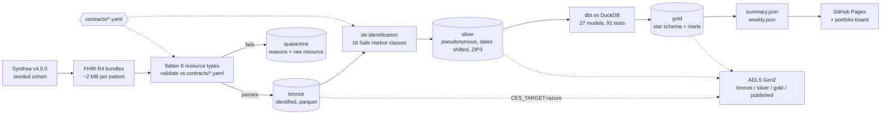

# Clinical Event Stream

**Live page: https://myselfgitcone.github.io/clinical-event-stream/**

A hospital's patient events as HL7 FHIR R4, validated against contracts,
de-identified before anything reaches silver, modelled as a star schema, and
landed in Azure Data Lake Storage Gen2. Built to answer one question on a few
thousand patients: **which chronic conditions travel together, and where are
the care gaps after a type 2 diabetes diagnosis, by age band and payer?**

**Nothing here is real.** Every patient is generated by
[Synthea](https://github.com/synthetichealth/synthea) from a fixed seed. The
de-identification follows the HIPAA Safe Harbor identifier list and every rule
is tested, but it is demonstrated on data that was never anybody's. That is the
only lawful way to show this work publicly, and it also means this is not a
compliance claim about any system.



## What's in here

| Layer | Tech | What it does |
| --- | --- | --- |
| Source | Synthea (Java), fixed population seed, clinician seed and reference date | 2,000 alive plus 268 deceased Missouri patients as FHIR R4 transaction bundles; byte-for-byte reproducible |
| Contracts | YAML, one per resource type | Field types, required, enums, ranges, cross-field rules, the Safe Harbor class of every field and what de-identification does to it |
| Ingest | Python, pyarrow | Flattens Patient, Encounter, Condition, Observation, MedicationRequest, Procedure, Immunization, Claim; validates every row; writes bronze and quarantine parquet per cohort |
| De-identification | Python, HMAC-SHA256 | Pseudonyms for every id, per-patient date shift, ZIP3 with the HHS low-population list, ages over 89 banded, free-text sweep; an audit row per table |
| Warehouse | dbt-duckdb | Staging views, type 2 patient dimension, five dims, six facts, two marts, three reports; 91 tests including four singular tests that prove no identifier reached gold |
| Feeds and page | JSON on GitHub Pages | `summary.json` and `weekly.json`, read by `site/` and by my portfolio board over CORS |
| Azure | Bicep, azure-storage-file-datalake | ADLS Gen2 account with one filesystem per layer, a $1 budget alert, Synapse serverless views over gold |
| CI | GitHub Actions | Lint, 64 unit tests, then a real 40-patient cohort through every stage with dbt's tests and a feed check |

## Quickstart

Python 3.11+ and Java 17 on the PATH. The first run downloads the 200 MB
Synthea jar (checksum pinned) and generates 2,000 patients, which takes about
25 minutes on a laptop and 8 GB of disk. Use a smaller number to try it.

```powershell
.\run.ps1 -Patients 200
```

```bash
./run.sh 200
```

Either way that is `ces run`: generate, ingest, de-identify, dbt build, export
gold parquet, write the feeds. Each stage is also its own command
(`ces generate|ingest|deid|transform|export|land`). Then look at the page:

```powershell
.\.venv\Scripts\python -m http.server -d site 8000
```

The tests run without Java:

```powershell
.\.venv\Scripts\python -m pytest
```

## Results from a real run

Cohort `c20261118`: seed 20261118, reference date 2026-11-18, Missouri, on a
laptop, 2026-11-18.

| Stage | What happened |
| --- | --- |
| Synthea | 2,268 bundles (2,000 alive, 268 deceased), 7.8 GB of JSON, 2,610,053 resources of the eight types, 753,699 resources of twelve other types counted and skipped |
| Bronze | 2,610,053 rows in 299 s. **0 quarantined**: every Synthea resource met its contract. The quarantine is exercised in CI by corrupting fixtures (inverted encounter period, condition without a code, duplicate patient) |
| Silver | 2,610,053 rows de-identified in 84 s: 8.4 million ids pseudonymised, 5.4 million dates shifted, 23 columns dropped |
| Gold | dbt 1.12 on DuckDB: 27 models, 91 tests, 0 failures, 7.6 s. Warehouse file 180 MB |

### Which chronic conditions travel together?

Patients carrying both conditions, out of 2,268, and lift against independence
(1.0 would mean the two are unrelated):

| Pair | Patients | Share | Lift |
| --- | --- | --- | --- |
| hypertension + metabolic syndrome | 287 | 12.7% | **3.37** |
| metabolic syndrome + obesity | 321 | 14.2% | 1.88 |
| coronary heart disease + obesity | 327 | 14.4% | 1.72 |
| anemia + hypertension | 324 | 14.3% | 1.61 |
| hypertension + obesity | 426 | 18.8% | 1.57 |
| anemia + obesity | 588 | 25.9% | 1.46 |

The strongest signal is the one medicine expects: hypertension is part of the
definition of metabolic syndrome, so a lift above 3 is the model agreeing with
the textbook, not a discovery. Anemia sits in so many pairs because Synthea's
modules assign it broadly; it says something about the generator, not about
patients.

### Care gaps after a type 2 diabetes diagnosis

166 patients have a type 2 diabetes diagnosis. Two measures, with the window
counted from the first diagnosis and every date of a patient shifted by the
same amount, so the windows are exact:

| | Eligible | Met | Share |
| --- | --- | --- | --- |
| Statin ordered within 365 days (ages 40 to 75 at diagnosis) | 116 | 13 | **11.2%** |
| HbA1c resulted within 90 days (everyone) | 166 | 55 | **33.1%** |

| By payer type | Diabetics | Statin | HbA1c |
| --- | --- | --- | --- |
| private | 75 | 11.5% | 34.7% |
| public (Medicare, Medicaid, dual) | 57 | 12.2% | 43.9% |
| no insurance | 34 | 8.7% | 11.8% |

Uninsured patients get the HbA1c a third as often as insured ones. That gap is
planted by Synthea's payer model, which lets uninsured patients skip care; it is
the kind of pattern a real payer dataset shows and a good test that the measure
is wired correctly. The low statin share across every payer is also a Synthea
artifact: its diabetes module manages glucose and does not model lipid therapy
the way guidelines do. On real data I would expect the opposite order of
magnitude.

### What de-identification leaves behind

Safe Harbor removes direct identifiers; it does not make a record anonymous.
`rpt_k_anonymity` groups the de-identified patients on the six quasi-identifiers
that survive (age band, gender, race, ethnicity, state, ZIP3):

| | |
| --- | --- |
| Groups | 514 |
| Smallest group | 1 |
| Patients unique on all six | 201 (8.9%) |
| Patients in groups smaller than 5 | 28.7% |
| Patients in groups smaller than 11 | 57.5% |

A release that needs k ≥ 5 would have to drop ZIP3 or coarsen race and
ethnicity. The warn-level dbt test fires when more than half the patients sit in
groups under 5; today it does not.

### Three things the data taught me

**One in four medication orders had no code, until I read the reference.**
`MedicationRequest.medication[x]` is a choice type. Synthea writes an inline
`medicationCodeableConcept` for prescriptions, but for administered drugs it
writes a `medicationReference` to a `Medication` resource elsewhere in the same
bundle. My first contract quarantined 1 of 109 orders in a 3-patient smoke run.
On the full cohort that would have been 29,664 of 102,565 orders (29%). The
flattener now resolves the reference inside the bundle; the contract still
quarantines an order with neither form.

**The audit caught my own bug.** The free-text sweep replaces anything that
looks like a URL, IP, SSN, phone or email with `[removed]`. The first silver
build reported 1,730,385 sweeps on 1,730,385 observation rows. It had rewritten
every `code_system` (`http://loinc.org`, `http://snomed.info/sct`) as a URL.
Sweeping is now opt-in per field through `free_text: true` in the contract, a
test pins the LOINC URI, and the audit count is back to meaning something.

**Synthea leaks identity in two places a FHIR parser does not look.** The
output file name is `Firstname_Lastname_uuid.json`, so bronze records only the
file's SHA-256. And `Patient.text.div` carries `Person seed: -4967725919621401576`,
a number unique to that patient; the narrative is dropped as class 18.

## De-identification, class by class

Every field in `contracts/*.yaml` carries a Safe Harbor class (`phi`) and an
action (`deid`). `tests/test_deid.py` has one test per class against a patient
built to carry all eighteen, and `tests/test_pipeline.py` proves that no
identifier value from the raw bundles (names, numbers, addresses, birth dates,
coordinates, UUIDs, the Synthea seed) appears anywhere in any silver table.

| # | Identifier class | What happens | Where it is proven |
| --- | --- | --- | --- |
| 1 | Names | dropped, including maiden and mother's maiden names and `display` text on references | `test_01_names` |
| 2 | Geography below state | street, city, lat/lon, birthplace city dropped; ZIP to ZIP3, `000` for the 17 prefixes HHS lists | `test_02_geography_below_state`, `zip3_shape` dbt test |
| 3 | Dates | shifted per patient by HMAC-derived [-365, 365] days; birth date to shifted year; over 89 banded 90+ | `test_03_dates…`, `assert_age_cap` |
| 4 | Phone | dropped | `test_04_phone` |
| 5 | Fax | dropped | `test_05_fax` |
| 6 | Email | dropped | `test_06_email` |
| 7 | SSN | dropped; never echoed in quarantine reasons | `test_07_ssn`, `test_phi_values_never_appear_in_reasons` |
| 8 | Medical record number | dropped | `test_08_medical_record_number` |
| 9 | Health plan beneficiary number | dropped from Claim insurance | `test_09_health_plan_beneficiary_number` |
| 10 | Account numbers | never flattened | `test_10_account_numbers` |
| 11 | Certificate and licence numbers | driver's licence and passport dropped | `test_11_certificate_and_licence_numbers` |
| 12 | Vehicle identifiers | never flattened | `test_12_vehicle_identifiers` |
| 13 | Device identifiers | `Device` resources are not flattened | `test_13_device_identifiers` |
| 14 | URLs | photo URL dropped; free text swept | `test_14_urls` |
| 15 | IP addresses | free text swept | `test_15_ip_addresses` |
| 16 | Biometric identifiers | dropped with the photo | `test_16_biometric_identifiers` |
| 17 | Full-face photographs | dropped | `test_17_full_face_photographs` |
| 18 | Any other unique identifier | every resource id replaced by a 32-hex HMAC pseudonym; Synthea narrative with its person seed dropped | `test_18_…`, `pseudonym_shape`, `assert_no_raw_uuid_keys` |

The pseudonym and the shift both come from HMAC-SHA256 under `CES_DEID_SALT`.
The mapping is never written. Without the salt a pseudonym cannot be reversed
and a shifted date cannot be un-shifted. The local default salt exists so the
pipeline runs with no setup; CI and the weekly publish refuse to run without a
real one.

Two honest caveats. Date shifting keeps intervals, which the care-gap measures
need; strict Safe Harbor keeps only the year
([ADR 0002](docs/adr/0002-date-shifting-over-year-only.md)). And `provider_org_id`
is Synthea's facility UUID, an organisation rather than a person, so it is kept
as the provider dimension's key; the UUID sweep in the tests excludes that one
column on purpose.

## Design decisions

**Contracts drive validation, schemas and de-identification.** One YAML per
resource type is the only description of a flattened row. It builds the Arrow
schema for bronze and silver, drives the validator, and tells the de-identifier
what to do with each field. A field with a `phi` class and `deid: keep` is a
unit-test failure. → [ADR 0001](docs/adr/0001-contracts-drive-validation-and-deidentification.md)

**Bad data is quarantined, never dropped.** A resource that fails its contract
goes to `bronze/quarantine` with every reason and the raw resource, keyed to its
cohort and bundle hash. `gold.rpt_quarantine` turns the reasons into a report
without the payload. Duplicates within a cohort are quarantined too.

**Bronze is identified and stays behind the de-identification step.** Nothing
reads bronze except `ces deid`. dbt's sources point at silver only; the one
bronze source is the quarantine, read without its raw column. In Azure each
layer is its own filesystem so bronze can carry the narrowest RBAC.

**Weekly cohorts, seeded by the ISO week.** Synthea cannot emit new encounters
for existing patients without a database behind it, so the weekly run generates
a fresh cohort (seed `YYYYWW`, reference date on the Monday) and the published
series accumulates. A re-run in the same week regenerates the same patients.
→ [ADR 0003](docs/adr/0003-weekly-series-lives-in-the-published-feed.md)

**Observations with components become rows.** A blood pressure is one FHIR
`Observation` with systolic and diastolic as components and no value of its
own. The flattener emits the parent (with `component_count`) plus one row per
component (`id#1`, `id#2`), so `fct_observation` has one value per row and the
contract can insist that a leaf observation carries a value.

**Payer comes from the claim.** Synthea's FHIR export names the payer only on
`Claim.insurance[].coverage.display`. The encounter's payer is the payer on its
non-pharmacy claim; pharmacy claims have no encounter and keep a null.

## Data model

```
bronze   patient, encounter, condition, observation, medication_request,
         procedure, immunization, claim, quarantine           (parquet per cohort, identified)
silver   the same eight tables de-identified, plus _audit     (parquet per cohort)
staging  stg_* views over silver; stg_cohort from the audit; int_encounter_payer
gold     dim_patient (type 2: patient_sk, valid_from/valid_to, is_current)
         dim_date, dim_condition (+ chronic_group), dim_medication (+ is_statin),
         dim_provider, dim_payer (+ payer_type)
         fct_encounter, fct_condition, fct_medication_request,
         fct_observation, fct_procedure, fct_immunization
         mart_condition_pairs       co-occurrence and lift of chronic groups
         mart_care_gaps             statin-within-year, HbA1c-within-90-days by age band and payer type
         rpt_quarantine, rpt_deid_audit, rpt_k_anonymity
```

The chronic groups and the payer types are dbt seeds (`transform/seeds/`), so
the clinical judgement is in a CSV anyone can review, not in SQL.

## Azure

The Azure path is behind one flag. With `CES_TARGET=azure` and a storage
account, `ces run` and `ces land` upload every layer to ADLS Gen2:

```
bronze/<table>/<cohort>.parquet    silver/<table>/<cohort>.parquet    gold/<table>.parquet
bronze/quarantine/<cohort>.parquet silver/_audit/<cohort>.parquet     published/summary.json, weekly.json
```

`infra/azure/main.bicep` creates the account (hierarchical namespace, no public
access, TLS 1.2, soft delete, bronze tiers to cool after 90 days), the four
filesystems and a monthly budget that mails at 80% of $1 actual and 100%
forecast. `infra/azure/synapse_gold_views.sql` puts Synapse serverless views
over the gold parquet so the question can be answered from Azure SQL without
copying anything.

What I had to correct from my own roadmap: Azure Event Hubs has no free tier
(Basic is about $11 a month per throughput unit), and Data Factory's five free
activities cannot run Python. So the compute for the free-tier edition is
GitHub Actions, the storage is ADLS Gen2 inside the 12-month 5 GB allowance,
and the query engine is Synapse serverless at $5 per TB scanned over a gold
layer of a few megabytes. An Event Hubs plus Spark Structured Streaming edition
fits inside the $200 first-month credit; it is on the roadmap, not in this repo.

Deployed 2026-11-20: account `cesjagadish7388` in `rg-clinical-event-stream`, East US 2,
created from the Bicep below; the first cohort's 40 files (bronze, silver, gold,
the two feeds) landed from the laptop with `ces land`.

### Setting it up (one time, about ten minutes)

1. Create the free account at https://azure.microsoft.com/free (needs a card; nothing is charged while the credit and the free amounts last). Install the Azure CLI and `az login`.
2. Pick a globally unique storage account name (3 to 24 lowercase letters and digits) and run
   ```powershell
   .\infra\azure\deploy.ps1 -StorageAccountName <name> -AlertEmail <you>
   ```
   It creates `rg-clinical-event-stream` in `eastus2`, deploys the Bicep, and prints the account key once.
3. Store the two values as repository secrets so the weekly publish lands the layers, and set a real salt:
   ```powershell
   gh secret set CES_AZURE_STORAGE_ACCOUNT --body <name>
   gh secret set CES_AZURE_STORAGE_KEY --body <key>
   gh secret set CES_DEID_SALT --body (-join ((1..48) | ForEach-Object { '{0:x}' -f (Get-Random -Maximum 16) }))
   ```
4. Within 30 days, upgrade the subscription to pay-as-you-go in the portal (Subscriptions → Upgrade) to keep the 12-month free amounts. The budget alert exists for exactly that moment.
5. Optional, for the SQL views: create a Synapse workspace (serverless pool only), give its managed identity Storage Blob Data Reader on the account, and run `infra/azure/synapse_gold_views.sql` with the account name filled in.

The account key is the simplest thing that works from GitHub Actions. The better
shape is a federated identity for the workflow with Storage Blob Data
Contributor scoped to the account; the code already accepts
`DefaultAzureCredential` when no key is set.

## The feeds and the page

`ces export` writes `site/data/summary.json` (the latest build: volumes, the
de-identification audit, k-anonymity, the condition pairs, the care gaps,
quarantine reasons, skipped resource types, dbt results) and
`site/data/weekly.json` (one point per ISO week). A run fetches the published
`weekly.json`, upserts its own week and writes the merged list, so the history
lives in the feed and nowhere else. GitHub Pages serves both with
`Access-Control-Allow-Origin: *`, which is how the portfolio board reads them.

`publish.yml` runs every Monday (GitHub's cron is late by minutes to hours;
nothing depends on the clock) and on demand: generate the week's cohort, run the
pipeline, validate the feeds with `scripts/check_feeds.py`, deploy the page, and
land in Azure when the secrets exist. `ci.yml` runs on every push: ruff, the 64
unit tests, then a real 40-patient cohort through every stage including dbt's
91 tests.

## Repo layout

```
contracts/           one YAML per resource type: fields, rules, phi class, deid action
src/ces/             config, synthea (seeded runs), fhir (flatten), contracts (validate),
                     ingest (bronze + quarantine), deid, silver, warehouse (dbt), export, azure_landing, cli
transform/           dbt project: sources over silver parquet, staging, gold, seeds, tests, macros
site/                static page + the two feeds (data/ is written by export, not committed)
infra/azure/         Bicep, deploy script, Synapse views
scripts/             feed validation used by CI
tests/               64 tests; fixtures are two trimmed Synthea bundles
docs/adr/            decision records
.github/workflows/   ci.yml (gate), publish.yml (weekly page + Azure landing)
```

## Limits

- **Synthetic end to end.** Synthea's clinical modules decide who gets a
  statin and who skips an HbA1c. The numbers show that the measures are wired
  correctly; they say nothing about care in Missouri.
- **Safe Harbor style, not strict.** Dates are shifted, not reduced to years.
  Seasonality is gone on purpose; the calendar in `dim_date` labels shifted dates.
- **Eight resource types.** DiagnosticReport, DocumentReference,
  ExplanationOfBenefit, CarePlan, CareTeam, AllergyIntolerance, Device,
  ImagingStudy, SupplyDelivery, MedicationAdministration, Provenance and
  Medication (resolved through MedicationRequest) are counted and skipped.
- **The type 2 dimension has one version per patient** because Synthea never
  re-emits a patient. The structure is exercised by the tests, not by the data.
- **Not streaming yet.** The bundles arrive as files and are processed as a
  batch per cohort. The Event Hubs and Spark Structured Streaming edition is
  the next step and costs money beyond the free amounts.
- **The CI warehouse holds the latest cohort only.** The multi-cohort history
  exists when `CES_TARGET=azure` is on; without it the series lives in `weekly.json`.
- **Provider names are kept.** Practitioner and organisation names are not
  patient identifiers under Safe Harbor; practitioner names are dropped anyway,
  organisation names are kept because the provider dimension needs them.
- **No real k-anonymity guarantee.** 8.9% of patients are unique on six
  quasi-identifiers. That is the measured truth of a Safe Harbor release.

## Assumptions I made

- Synthea `v4.0.0`, Missouri, population and clinician seed 20261118, reference date 2026-11-18, 2,000 alive patients; deceased patients kept so `deceased_datetime` and the age cap are exercised.
- Statins are identified by generic name in the RxNorm display; the eligible window follows the ADA's 40-to-75 recommendation; HbA1c is LOINC 4548-4.
- Chronic condition groups are my own grouping of Synthea's SNOMED codes (`transform/seeds/ref_chronic_conditions.csv`); payer types map Medicare, Medicaid and dual eligibility to `public`, `NO_INSURANCE` to `none`, everything else to `private`.
- A patient's age band is their age at the cohort's reference date, not at each event.
- The weekly publish generates 500 patients per week. The Pages feed, not the repository, holds the series.
- Great Expectations and Purview from my roadmap are not in this repo; dbt tests cover the data quality gate and the lineage is the dbt DAG. Both are candidates for the Azure edition.

## Roadmap

- Event Hubs (Kafka protocol) in front of Spark Structured Streaming inside the first-month credit, with the same contracts and de-identification applied per micro-batch.
- A source that updates patients (HAPI FHIR's public R4 server, which anyone can write to), so the type 2 dimension has something to version.
- DiagnosticReport and CarePlan as resource types nine and ten.
- Purview over the three ADLS filesystems; a Snowflake edition in a 30-day trial window with cost per query captured.
